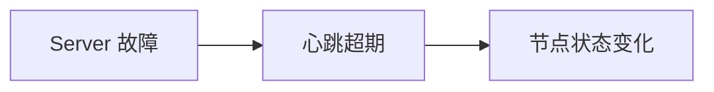

# Robin's Space (Hugo Stack)

个人站点 — Hugo Stack 主题版本。

## 快速开始

### 环境要求

- Hugo Extended ≥ v0.157.0（当前 v0.159.2）

### 本地预览

```bash
cd /data/code/hugo-stack-site

# 前台运行（Ctrl+C 停止）
hugo server --bind 0.0.0.0 --port 4002

# 后台运行
nohup hugo server --bind 0.0.0.0 --port 4002 > /tmp/hugo-serve.log 2>&1 &
```

访问 http://localhost:4002 或 Tailscale 内网 IP:4002

### 停止服务

```bash
lsof -ti:4002 | xargs kill
```

### 构建（不启动服务）

```bash
hugo
# 输出到 public/
```

## 目录结构

```
hugo-stack-site/
├── config/_default/
│   ├── hugo.toml        # 基础配置
│   ├── params.toml      # 主题参数（avatar、sidebar、widgets）
│   ├── markup.toml      # Markdown 渲染配置
│   └── menu.toml        # 导航菜单 + 社交链接
├── content/
│   ├── post/            # 博客文章（page bundle 格式）
│   └── page/            # 独立页面（About/Projects/Archives/Search）
├── static/images/       # 图片资源
├── assets/img/          # 主题资源（avatar）
├── themes/hugo-theme-stack/  # Stack 主题
└── README.md
```

## 文章列表

| 文章 | 日期 | 分类 |
|---|---|---|
| [构建 E2B 沙箱韧性：Nomad 心跳机制的发现与实践](content/post/e2b-sandbox-resilience-nomad-heartbeats/index.zh.md) | 2026-10-22 | Cloud Architecture |
| China CloudFront SSL Plugin V2 | 2025-08-19 | AWS > CloudFront |
| SageMaker GGUF 模型推理 | 2025-02-12 | AWS > SageMaker |
| API Gateway CORS 配置 | 2024-10-28 | AWS > API Gateway |
| WordPress GenAI Plus | 2024-04-29 | AWS, AI |
| CloudFront SSL 插件部署指南 | 2023-11-15 | AWS > CloudFront |
| ControlNet 艺术二维码 | 2023-09-01 | AI > Stable Diffusion |
| Photography: City Lights | 2024-01-15 | Photography |

## 添加新文章

在 `content/post/` 下创建目录 + `index.md`：

```bash
mkdir -p content/post/my-new-post
```

```yaml
---
title: "文章标题"
date: 2025-01-01
description: "简短描述"
image: /images/posts/my-post/cover.jpg
categories:
  - AWS
tags:
  - tag1
  - tag2
slug: my-new-post
---

正文内容...
```

### 文章图表（Mermaid）

当前 Stack 主题支持在 Markdown 中直接编写 Mermaid 流程图和时序图，无需先生成 PNG：

````markdown

````

修改代码块并保存，Hugo 预览会更新图表；主题提供明暗主题适配和放大查看。

如果希望所有示意图都直接在 Markdown 中维护，可以省略 front matter 的 `image`，将开篇图也写成 Mermaid 代码块。`image` 用于图片资源，不能填写 Mermaid；省略后，文章列表不显示该篇的图片缩略图。

开篇使用 Mermaid 时，可以先写一段介绍，再用 `<!--more-->` 结束自动摘要，然后放图，避免摘要包含图表源码。

图表由浏览器渲染，当前主题从 `cdn.jsdelivr.net` 加载 Mermaid，首次打开页面需要能访问该 CDN。

## 添加摄影作品

同样在 `content/post/` 下创建，category 设为 Photography：

```yaml
---
title: "相册名称"
date: 2025-01-01
categories:
  - Photography
tags:
  - street
  - travel
---


```

Stack 内置 lightbox，多张图片自动生成画廊效果。

## 三站对比

| 站点 | 端口 | 框架 | 主题 | 路径 |
|---|---|---|---|---|
| Minimal Mistakes | :4000 | Jekyll | MM | /data/code/git-page/ |
| Chirpy | :4001 | Jekyll | Chirpy | /data/code/chirpy-site/ |
| **Stack** | **:4002** | **Hugo** | **Stack** | **/data/code/hugo-stack-site/** |
