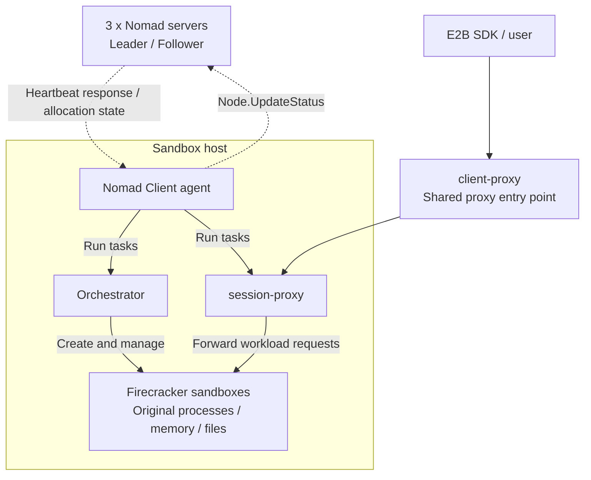
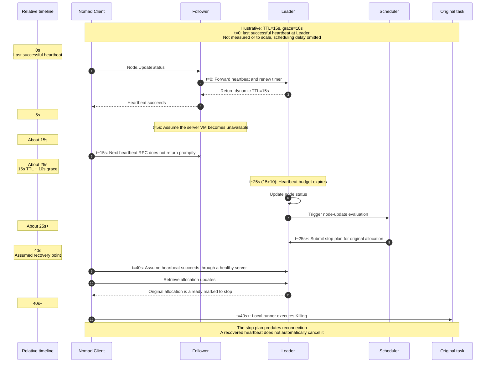
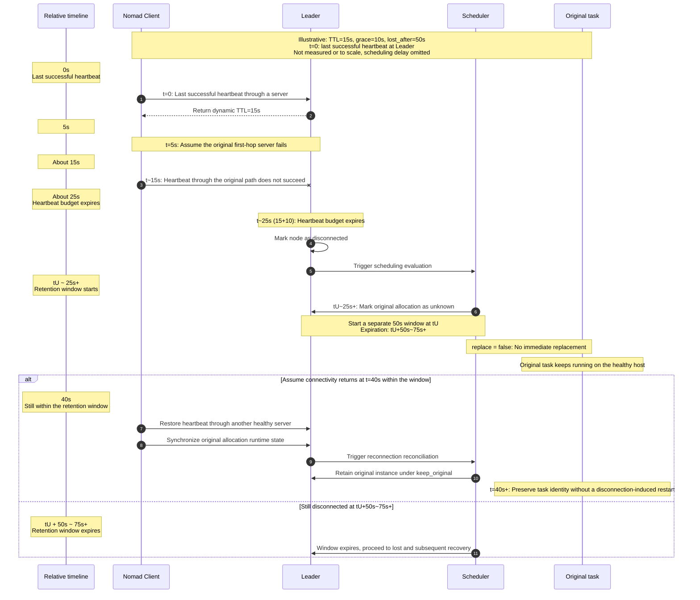
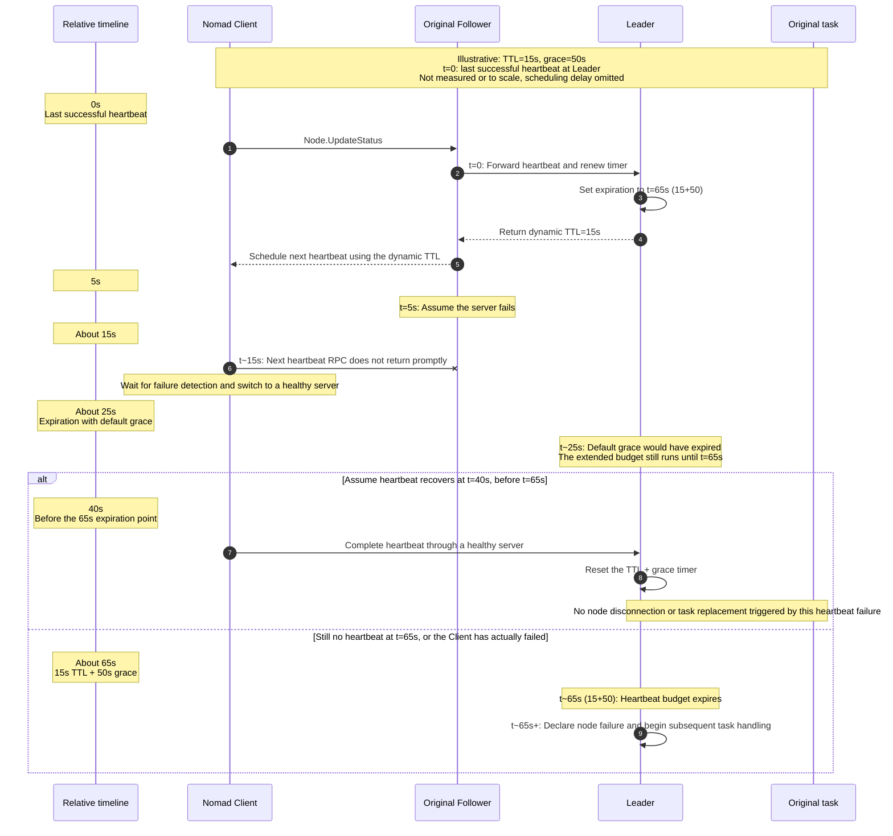

Running a self-hosted E2B cluster is about more than getting Firecracker sandboxes to start. We also need to consider how to keep them stable once they host long-running workloads. As a single cluster supports more sandboxes, resilience becomes increasingly important. **Our architecture needs to protect existing runtime state and user connections while limiting the impact on capacity for new sandboxes, so that a local interruption does not cause unnecessary disruption elsewhere.**

This article starts with a single Nomad server becoming unavailable. It describes what we learned about Server / Client heartbeats and the changes we explored to task preservation, node failure detection, and blast-radius control.

In this self-hosted environment, three Nomad servers form the control plane. The failure affected only the VM hosting one of them; the Clients running sandboxes and the other nodes remained healthy. Our initial expectation was straightforward: the remaining servers would keep the control plane available, Clients would switch to another healthy server, and workloads would continue running.

The tests revealed something counterintuitive: **only one server was lost, yet Orchestrator and other tasks on healthy Nomad Client hosts were replaced.** To understand why, we first needed to examine how Nomad servers and Clients use heartbeats to maintain contact, and what Nomad does with existing tasks when those heartbeats stop arriving.

<!--more-->

## How a Single Server Failure Affects an E2B Deployment

First, consider the relationship between E2B and Nomad. In this deployment, Nomad schedules and manages services such as the API, Orchestrator, session-proxy, and client-proxy. Orchestrator, in turn, manages Firecracker sandboxes on its host. **Sandbox creation and state management are handled by Orchestrator instances deployed on sandbox nodes and managed by Nomad.**



A Nomad Client is the agent running on a host. It communicates with servers and executes tasks. When Nomad schedules a task group onto a Client node, the resulting execution instance is called an **allocation**.

To observe whether a single server failure could trigger task replacement, we forcibly stopped one non-Leader server without configuring a disconnect retention policy. The other two servers maintained quorum, and we continued observing for approximately 11 minutes.

Tracking the identities of the original allocations, we recorded the following replacements for selected tasks:

| Task | Original allocations replaced / original total |
|---|---:|
| Orchestrator | **7 / 20** |
| session-proxy | **7 / 20** |
| client-proxy | **2 / 3** |

The experiment showed that **the control plane can instruct a Client to abandon its original tasks even when the Client host has neither failed nor restarted.**

For an E2B cluster, this is an important detail. Orchestrator manages sandbox runtime resources and participates in sandbox creation and state management. An unnecessary replacement can therefore affect sandboxes that are already running.

## The Unexpected Sequence: Tasks Stop After Heartbeats Recover

Using the platform's confirmation that the server had stopped as the observation baseline, we aligned Nomad Client logs with workload events:

- At approximately 21 seconds, we had captured a successful heartbeat from the Client to a healthy server.
- At approximately 39 seconds, the original task began `Killing`.
- At approximately 44 seconds, the original application stream closed.

The node and allocation states showed that **the Client executed a previously made stop decision only after reconnecting and receiving an update.** The overall sequence was:

```text
Heartbeat expires
-> Server updates node status and triggers a scheduling evaluation
-> Scheduler marks the original allocation as stop / lost
-> Client reconnects and retrieves the allocation update
-> Local task executes Killing
-> Replacement allocation starts
```

## Understanding Nomad Heartbeats: How Node Failure Detection Affects Workloads

With this question in mind, we examined Nomad's GitHub source code and official documentation. We traced the following call chain:

**Client sends a heartbeat -> RPC selects a server -> Follower forwards the request -> Leader renews the heartbeat timer -> Expiration updates node status -> Scheduler processes allocations -> Client applies task updates.**

The sequence diagram below provides the full picture before we walk through the code. Its timestamps are illustrative and start from the last successfully processed heartbeat at the Leader. The log timestamps above start from the platform's stop confirmation, so the two timelines do not correspond directly.



The following sections walk through the key code paths. The snippets have been simplified.

### 1. Client Heartbeats Report Node Status

On the Client, [`registerAndHeartbeat()`](https://github.com/hashicorp/nomad/blob/bf24b0dd97430d3b364b68b1f7375e85e585778f/client/client.go#L1870-L1923) handles registration and periodic heartbeats. The actual request is constructed in [`updateNodeStatus()`](https://github.com/hashicorp/nomad/blob/bf24b0dd97430d3b364b68b1f7375e85e585778f/client/client.go#L2236-L2274):

```go
req := structs.NodeUpdateStatusRequest{
    NodeID: c.NodeID(),
    Status: structs.NodeStatusReady,
}
var resp structs.NodeUpdateResponse
if err := c.RPC("Node.UpdateStatus", &req, &resp); err != nil {
    return err
}
c.heartbeatTTL = resp.HeartbeatTTL
```

The request reports the **NodeID and node status**, not the application health of a particular Job. After a successful response, the Client uses `HeartbeatTTL` to schedule its next heartbeat. After a failure, the heartbeat loop schedules a retry and triggers server discovery.

Multiple tasks on the same Client therefore share the node heartbeat. `Node.UpdateAlloc` reports allocation state, while Orchestrator's gRPC health check measures application health. Neither replaces this Client-to-Server heartbeat.

### 2. One Server per RPC Attempt: Switching Paths Waits for the Call to Return

Next, consider the Client's [`rpc()`](https://github.com/hashicorp/nomad/blob/bf24b0dd97430d3b364b68b1f7375e85e585778f/client/rpc.go#L83-L146). The key sequence, simplified, is:

```go
server := c.servers.FindServer()
rpcErr := c.connPool.RPC(c.Region(), server.Addr, method, args, reply)
if rpcErr != nil {
    c.servers.NotifyFailedServer(server)
}
```

The Client first selects a server and then makes the RPC through the connection pool. **Only after the current call returns an error** does it report the server failure and decide whether to retry at the RPC layer, based on the error type and remaining budget. If the error is not safe to retry automatically, it returns to the heartbeat loop above.

The important delay here is how long it takes an RPC to return an error after a connection fails. Under the [default configuration](https://developer.hashicorp.com/nomad/docs/configuration/rpc) and [yamux implementation](https://github.com/hashicorp/yamux/blob/v0.1.2/session.go#L327-L379), when an established connection silently fails, the Keepalive interval is 30 seconds, and a Ping waits approximately 10 seconds for a Pong. Assuming the Ping write does not block and no Ping was already in flight before the failure, detecting the failure can take roughly 10-40 seconds, depending on the Keepalive phase.

The retry budget is also checked only after the underlying call returns; it cannot interrupt that call early. This creates a possible race: **the connection is still waiting to confirm a failure while the Leader's node heartbeat budget has already expired.**

### 3. Heartbeats Can Pass Through a Follower, but the Leader Renews the Timer

When a server receives the request, it first passes through the forwarding check in [`Node.UpdateStatus()`](https://github.com/hashicorp/nomad/blob/bf24b0dd97430d3b364b68b1f7375e85e585778f/nomad/node_endpoint.go#L655-L678):

```go
if done, err := n.srv.forward("Node.UpdateStatus", args, args, reply); done {
    return err
}
```

[`forward()`](https://github.com/hashicorp/nomad/blob/bf24b0dd97430d3b364b68b1f7375e85e585778f/nomad/rpc.go#L603-L618) determines whether the current server should handle the request. If it is not the Leader, it forwards the request to the Leader.

The Client does not need to contact the Leader directly every time, but its selected first-hop server must deliver the request promptly. **If the Follower stops responding and the Client cannot switch paths in time, a healthy Leader may still fail to receive that Client's heartbeat.**

### 4. The Leader Waits for the Dynamic TTL Plus Grace

Once the heartbeat successfully reaches the Leader, it calls [`resetHeartbeatTimer()`](https://github.com/hashicorp/nomad/blob/bf24b0dd97430d3b364b68b1f7375e85e585778f/nomad/heartbeat.go#L93-L135). The function calculates an interval based on cluster size and then adds random jitter:

```go
ttl := helper.RateScaledInterval(
    h.srv.config.MaxHeartbeatsPerSecond,
    h.srv.config.MinHeartbeatTTL,
    len(h.heartbeatTimers),
)
ttl += helper.RandomStagger(ttl)
h.resetHeartbeatTimerLocked(id, ttl+h.srv.config.HeartbeatGrace)
return ttl, nil
```

**The returned `ttl` determines the Client's next heartbeat interval, while the Leader sets its expiration timer to `ttl + HeartbeatGrace`.** `heartbeat_grace` adds time for the Server to wait for the next successful heartbeat.

Following the [official heartbeat documentation](https://developer.hashicorp.com/nomad/docs/configuration/server#client-heartbeats), the normal path can be understood as:

```text
Reference node expiration time
  = Time when the Leader last successfully processed a heartbeat and reset its timer
  + Dynamic heartbeat TTL for that round
  + heartbeat_grace
```

In this small cluster, the normal TTL was approximately 10-20 seconds. With the default 10-second grace, the Leader's budget before declaring a Client's heartbeat expired was approximately 20-30 seconds.

### 5. Timer Expiration Changes Node Status Before Triggering Scheduling

When the timer expires, the Leader runs [`invalidateHeartbeat()`](https://github.com/hashicorp/nomad/blob/bf24b0dd97430d3b364b68b1f7375e85e585778f/nomad/heartbeat.go#L137-L181). The key node-status branch is:

```go
req.Status = structs.NodeStatusDown
if canDisconnect && hasPendingReconnects {
    req.Status = structs.NodeStatusDisconnected
}
```

Whether the node enters `disconnected` depends on whether its allocations support reconnection and remain within their recovery windows. Not every heartbeat expiration leads to the same state transition.

The [node-status update path](https://github.com/hashicorp/nomad/blob/bf24b0dd97430d3b364b68b1f7375e85e585778f/nomad/node_endpoint.go#L816-L873) then persists the necessary state changes through Raft and creates scheduling evaluations for the relevant transitions. The scheduler uses the Job type and disconnect policy to decide which allocations to retain temporarily, which to mark `lost`, and whether to create replacements.

For example, [stop calculations for service allocations](https://github.com/hashicorp/nomad/blob/bf24b0dd97430d3b364b68b1f7375e85e585778f/scheduler/reconciler/reconcile_cluster.go#L1097-L1127) handle the lost set, while the [node reconciliation logic for system Jobs](https://github.com/hashicorp/nomad/blob/bf24b0dd97430d3b364b68b1f7375e85e585778f/scheduler/reconciler/reconcile_node.go#L185-L263) distinguishes reconnectable `unknown` allocations from those that need to be treated as lost.

**A heartbeat timeout does not mean the Leader directly sends a kill signal to an application process.** Node-status updates and scheduling plans sit between those events, and that is where the following configuration changes can intervene.

### 6. After Reconnecting, the Client Applies an Allocation Update That Already Exists

The Client retrieves server-side allocation changes through [`watchAllocations()`](https://github.com/hashicorp/nomad/blob/bf24b0dd97430d3b364b68b1f7375e85e585778f/client/client.go#L2482-L2545). Once an update reaches the local runner, [`handleAllocUpdate()`](https://github.com/hashicorp/nomad/blob/bf24b0dd97430d3b364b68b1f7375e85e585778f/client/allocrunner/alloc_runner.go#L1078-L1101) checks whether the allocation is transitioning to a terminal state:

```go
stopping := !ar.Alloc().TerminalStatus() && update.TerminalStatus()
ar.setAlloc(update)
if stopping {
    ar.killTasks()
}
```

The terminal-state check also includes the Server's desired state. Even if the original task is still running, the local runner stops it if the received update already requires termination.

This connects the cause and effect seen in the logs: **the Client did not switch heartbeat paths before its budget expired, so the Server updated node status and the scheduler created a stop plan. When the Client later reconnected, it applied the update and stopped the original task. Replacement means a new allocation starts, not that a task restarts within the original allocation.**

The community has also discussed similar symptoms in [hashicorp/nomad#17974](https://github.com/hashicorp/nomad/issues/17974).

Understanding this chain reveals two intervention points: **allow more time to switch heartbeat paths before declaring a node disconnected, or give the original tasks a chance to reconnect after that declaration.**

## Solution 1: Preserve Original Tasks and Access Paths with disconnect

For E2B, the first priority is to avoid unnecessarily replacing Orchestrator on a healthy Client because of a brief control-plane disconnection.

We used Nomad's `disconnect` policy to separate "detect that the node is disconnected" from "immediately abandon its original tasks." The configuration belongs in an existing Job's **task group**, for example:

```hcl
group "orchestrator" {
  disconnect {
    lost_after = "50s"
    replace    = false
    reconcile  = "keep_original"
  }

  # Keep the existing task, network, and other definitions unchanged.
}
```

Orchestrator, session-proxy, and client-proxy should each be evaluated and configured in their respective groups where protection is needed.

| Setting | What it addresses |
|---|---|
| `lost_after = "50s"` | Provides a bounded reconnection window after an allocation enters `unknown` |
| `replace = false` | Prevents immediate replacement during the disconnect retention phase |
| `reconcile = "keep_original"` | Prefers the original instance during applicable reconnection reconciliation |

Explicitly setting `replace = false` prevents an immediate replacement from being created within the retention window. The corresponding [scheduler check](https://github.com/hashicorp/nomad/blob/bf24b0dd97430d3b364b68b1f7375e85e585778f/scheduler/reconciler/filters.go#L527-L544) is:

```go
if isDisconnecting && !alloc.ReplaceOnDisconnect() {
    return
}
```

The other distinction is when the window starts. [`Allocation.Expired()`](https://github.com/hashicorp/nomad/blob/bf24b0dd97430d3b364b68b1f7375e85e585778f/nomad/structs/alloc.go#L756-L779) calculates expiration from the allocation's most recent transition into `unknown`:

```go
lastUnknown := a.LastUnknown()
expiry := lastUnknown.Add(tg.GetDisconnectLostAfter())
return expiry.Sub(now) <= 0
```

Therefore, `lost_after = "50s"` does not mean waiting 50 seconds from the server's failure, and it is not equivalent to `heartbeat_grace = "50s"`. Assuming a TTL of 15 seconds and a grace of 10 seconds, the approximate sequence is:

```text
t = 0        Last successful heartbeat at the Leader
t ~ 25s      Heartbeat expires; node disconnection handling begins
t ~ 25s+     Relevant allocation enters unknown
t ~ (25+50)=75s+     If recovery has not completed, the 50-second retention window expires
```

### disconnect Sequence: Retain the Original Task, Then Wait for Reconnection

The following diagram assumes that the original task on a healthy Client is still running. It shows how the `50s / false / keep_original` policy handles a brief disconnection:



This does not extend the node's heartbeat budget. Instead, it delays the decision to abandon the original allocation: **enter `unknown`, avoid immediate replacement, and wait for the original instance to reconnect.** The node may still not be `ready` during this period, and retaining the original instance is no longer guaranteed after the window expires.

Protection also needs to follow the user access path. Preserving Orchestrator alone does not necessarily preserve an existing connection. If client-proxy is replaced, the sandbox can remain alive while the connection breaks. We therefore included session-proxy and client-proxy in the validation.

In one test with a 50-second disconnect window, Nomad Clients did briefly enter `disconnected`. The observed `unknown` intervals for their original allocations were approximately 1.7-31.6 seconds, followed by recovery within the window:

| Validation item | Observation |
|---|---|
| Orchestrator, session-proxy, and client-proxy | Original allocations preserved; no additional task restarts |
| Original sandbox process identities, memory, and files | 10 / 10 preserved; final independent checks completed |
| Original HTTP NDJSON streams | 23 / 23 preserved |
| Short requests during the formal observation period | 12,581 requests, 0 errors |

With disconnect configured, **the Clients briefly lost control-plane contact, but their original tasks remained in place until reconnection, without being replaced.**

## Beyond Task Preservation: How Node Status Affects Sandbox Creation Capacity

`disconnect` preserves original tasks; it does not prevent a Client from being declared disconnected after its heartbeat expires. In other words, **Orchestrator and existing sandboxes can remain running without the node remaining eligible to receive new sandbox placements.**

In this E2B implementation, the API normally synchronizes node information from Nomad every 20 seconds, selecting nodes in the sandbox node pool whose status is `ready`. The core filter is:

```go
options := &nomadapi.QueryOptions{
    Filter: `Status == "ready" and NodePool == "default"`,
}
```

If the query succeeds but a previously known node no longer appears in the results, the API marks it `unhealthy`, affecting subsequent placement.

The public E2B runtime also has an implementation that discovers Orchestrators through allocations. Its [discovery filter](https://github.com/e2b-dev/runtime/blob/afaaeaef96aae86f65ce60bf38fe083e7638a28e/packages/shared/pkg/clusters/discovery/nomad.go#L29-L57) requires `ClientStatus == "running"`. Its [API synchronization logic](https://github.com/e2b-dev/runtime/blob/afaaeaef96aae86f65ce60bf38fe083e7638a28e/packages/api/internal/orchestrator/cache.go#L195-L211) also removes an original instance from the local node pool when that instance no longer appears in valid discovery results.

The two implementations filter different objects, but they highlight the same issue: **placement decisions depend on Nomad's state, not only on whether the original Orchestrator process is alive.**

Under a high sandbox creation rate, some healthy hosts may continue running existing sandboxes while temporarily being unable to share the load of new requests. Creation pressure shifts to the remaining eligible nodes. If they lack sufficient capacity, creation can fail, queue, or time out.

**This is fundamentally a blast-radius problem.** The failure originates in a single server and directly disrupts communication for some Clients. Node state then affects API placement, transferring pressure to other healthy nodes. `disconnect` contains the "destroy original tasks" path, but it does not automatically contain the "exclude healthy capacity" and "overload the remaining nodes" paths.

## Solution 2: Reduce False Node Failure Detections with heartbeat_grace

`disconnect` addresses the situation after a node has been declared disconnected: do not abandon its original tasks immediately. Since node state also affects creation capacity, we need to look one step earlier. Can we give the Client enough time to switch paths before declaring it disconnected?

This is where the Server-side **`heartbeat_grace`** setting applies:

```hcl
server {
  heartbeat_grace = "50s"
}
```

It adds time beyond the dynamic TTL. Changing the default grace from 10 to 50 seconds adds 40 seconds of headroom. Combined with the normal TTL of approximately 10-20 seconds, the reference budget becomes roughly 60-70 seconds from the last successful heartbeat.

### heartbeat_grace Sequence: Allow More Switching Time Before Declaring a Node Disconnected

Unlike disconnect, this changes how long the Leader waits for the next successful heartbeat. The example still assumes that the same Leader remains healthy throughout:



Across two complete server-stop tests with grace set to 50 seconds and no disconnect policy on the key tasks, none of the 20 surviving Clients in either run was observed entering `down` or `disconnected`, and no original tasks were replaced. This matched the expected behavior: **if switching completes before the budget expires, there is no need to enter the subsequent disconnection and task-handling paths.**

**`heartbeat_grace` gives the Leader more time to wait.** If connectivity recovers in time, that heartbeat failure does not lead to a node-disconnection decision.

However, the cost becomes clearer when a Client actually fails. When a Server fails but the Client is healthy, we want to wait a little longer. When the Client's host really has failed, we want to detect it quickly and stop placing work there. The same heartbeat signal cannot guarantee both "never falsely mark a healthy node down" and "immediately detect a real failure." A longer grace delays real Client-failure detection at the Nomad heartbeat layer, although application health checks may exclude the failed node earlier.

From a blast-radius perspective, the two adjustments place the cost at different points:

| Adjustment | Benefit | Cost and boundary |
|---|---|---|
| Moderately increase `heartbeat_grace` | Give the Leader more time for the next heartbeat, reduce false failure detections on healthy Clients, and lower the risk of unnecessary task replacement or exclusion from the creation pool | Real Client failures also become visible later at the Nomad heartbeat layer |
| Shorter grace + targeted `disconnect` | Expose disconnection sooner after a real Client failure while giving original tasks a short reconnection window | During a Server failure, some healthy Clients may still temporarily leave the creation pool, shifting pressure to the remaining nodes |

## Summary: Turning Heartbeat Findings into Sandbox Resilience

This investigation started with a simple question: why were tasks on healthy hosts rebuilt when only one Server was lost? Following the logs and code revealed a chain of architectural decisions that affect workloads: **whether a heartbeat arrives in time, whether the node is declared disconnected, whether the original tasks are retained, and whether the layer above still treats the node as available capacity.**

For E2B, we need to protect three goals separately:

1. **Existing sandbox runtime state**: Separate node disconnection from immediately abandoning original tasks, leaving room to recover from brief control-plane failures.
2. **Existing user connections**: Cover Orchestrator, session-proxy, and client-proxy rather than only verifying that the sandbox still exists.
3. **Creation capacity and real-failure recovery**: Observe both the erroneous exclusion of healthy nodes and delays in detecting failed nodes or replacing tasks, while maintaining headroom on the remaining capacity.

Ultimately, resilience does not mean every failure causes zero interruption. It means preserving valuable runtime state during short disconnections, keeping recovery bounded when a real failure occurs, and limiting the knock-on effects to a level the workload can tolerate.

## References

- [Nomad Server Configuration: heartbeat_grace](https://developer.hashicorp.com/nomad/docs/configuration/server#heartbeat_grace)
- [Nomad Client Heartbeats](https://developer.hashicorp.com/nomad/docs/configuration/server#client-heartbeats)
- [Nomad disconnect Specification](https://developer.hashicorp.com/nomad/docs/job-specification/disconnect)
- [Nomad Client Heartbeat Scheduling](https://github.com/hashicorp/nomad/blob/bf24b0dd97430d3b364b68b1f7375e85e585778f/client/client.go#L1870-L1923)
- [Nomad Leader Heartbeat Timers and Expiration](https://github.com/hashicorp/nomad/blob/bf24b0dd97430d3b364b68b1f7375e85e585778f/nomad/heartbeat.go#L56-L181)
- [Nomad Allocation Disconnect Expiration](https://github.com/hashicorp/nomad/blob/bf24b0dd97430d3b364b68b1f7375e85e585778f/nomad/structs/alloc.go#L756-L779)
- [E2B Runtime: Nomad Discovery Filters](https://github.com/e2b-dev/runtime/blob/afaaeaef96aae86f65ce60bf38fe083e7638a28e/packages/shared/pkg/clusters/discovery/nomad.go#L29-L57)
- [E2B Runtime: API Node Synchronization](https://github.com/e2b-dev/runtime/blob/afaaeaef96aae86f65ce60bf38fe083e7638a28e/packages/api/internal/orchestrator/cache.go#L53-L120)
- [hashicorp/nomad#17974: Non-Leader Connectivity Problems and Allocation Restarts](https://github.com/hashicorp/nomad/issues/17974)
