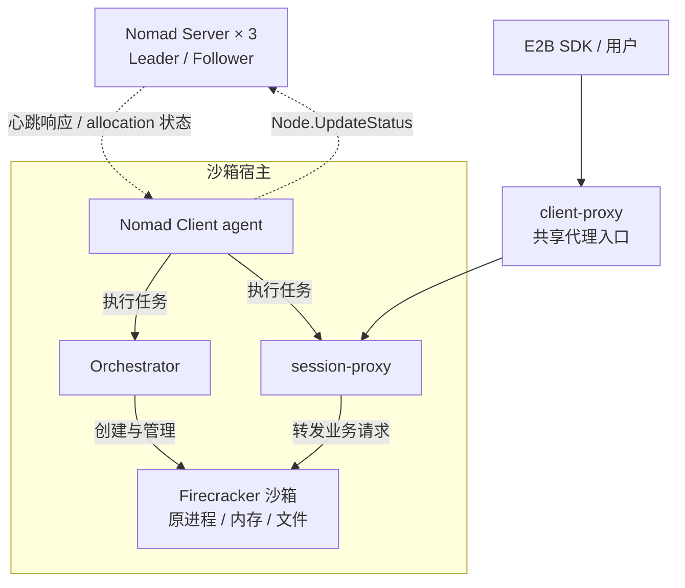
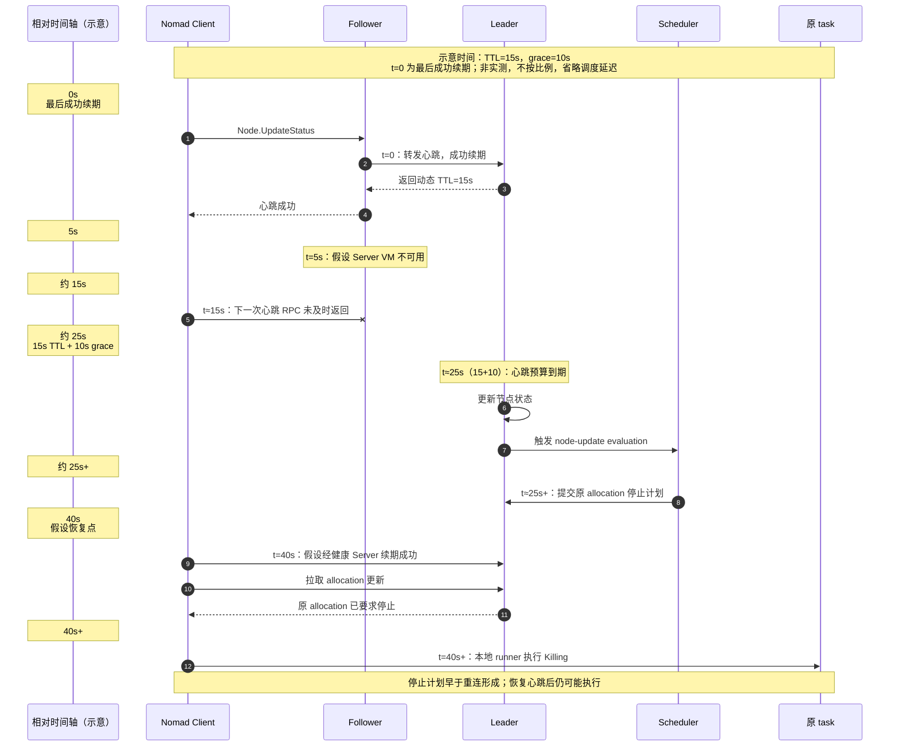
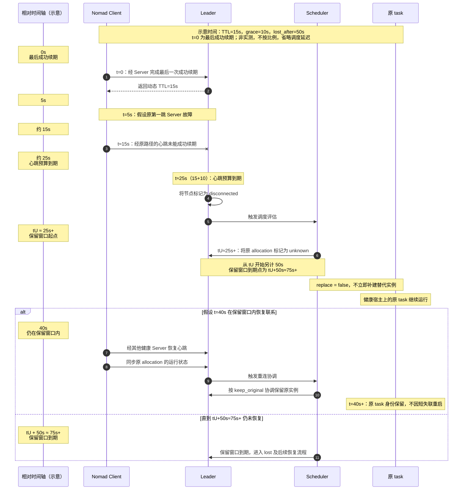
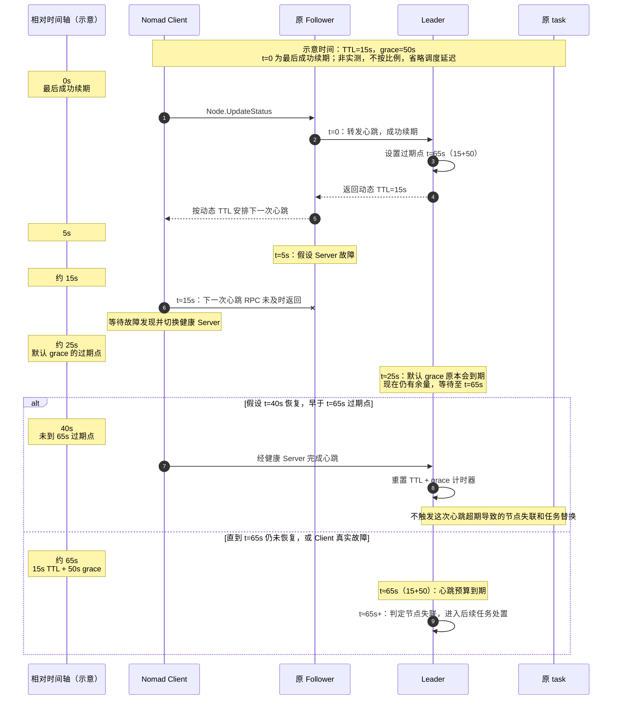

自建 E2B 集群，不只是让 Firecracker 沙箱正常启动，还要考虑它承载持续运行的工作负载后，如何保证稳定性。随着单个集群承载的沙箱数量增加，沙箱韧性也变得更加重要。**在架构设计中，我们既要尽量保护已有运行态和用户连接，也要控制故障对新建容量的影响，避免一次局部中断扩散成不必要的业务影响。**

这篇文章以单台 Nomad Server 不可用的场景为切入点，记录我们对 Server / Client 心跳机制的发现，以及后续在任务保留、节点判定和爆炸半径控制上的调整。

在这套自建环境中，三台 Nomad Server 组成集群控制面。故障只涉及其中一台 Server 所在的虚拟机，运行沙箱的 Client 等其他节点依旧正常。按照最初的预期，剩余 Server 应该继续提供控制面服务，Client 切换到其他健康 Server，业务继续运行。

验证时却出现了一个反直觉的现象：**Server 只少了一台，其他健康宿主上的 Orchestrator 和Nomad Client任务却发生了替换。** 要弄清原因，需要先理解 Nomad Server 和 Client 怎么通过心跳保持联系，再看心跳断连之后，Nomad 会怎么处理原来的任务。

<!--more-->

## 从 E2B 部署关系看单台 Server 故障的影响

先看 E2B 集群与 Nomad 的关系。在这套自建环境里，Nomad 负责调度和管理 API、Orchestrator、session-proxy、client-proxy 等基础服务；Orchestrator 再负责管理宿主上的 Firecracker 沙箱。**沙箱的创建及状态维护，由部署在沙箱节点上、由 Nomad 管理的 Orchestrator 负责。**



这里的 Nomad Client 是运行在宿主上的 agent，负责与 Server 通信并执行任务。Nomad 将 task group 调度到 Client 节点后形成的执行实例，称为 **allocation**。

为观察单台 Server 故障是否会触发任务替换，我们在未配置断连保留策略的情况下，强制停止一台非 Leader Server，让另外两台继续维持多数派，并持续观察约 11 分钟。

按原 allocation 身份统计，部分任务的替换情况如下：

| 任务 | 原 allocation 被替换 / 原总数 |
|---|---:|
| Orchestrator | **7 / 20** |
| session-proxy | **7 / 20** |
| client-proxy | **2 / 3** |

实验结果表明，**即使执行任务的 Client 宿主没有故障、没有重启，控制面仍可能要求它放弃原任务。**

对于 E2B 集群，这是一个不可忽视的细节。Orchestrator 管理着沙箱的运行资源，参与沙箱的创建及状态维护，一次不必要的重建，可能进一步影响正在运行的沙箱。

## 问题的发现：心跳恢复后，Nomad Client 中的任务才终止

以平台确认 Server 停机为观察起点，将 Nomad Client 日志与业务事件对齐后，关键时间点如下：

- 约第 21 秒：已采到 Client 向健康 Server 的成功心跳。
- 约第 39 秒：原 task 开始 Killing。
- 约第 44 秒：原业务流关闭。

对照节点与 allocation 状态可知，**Client 恢复联系、取得更新后，才执行此前的停止决定。** 整体顺序如下：

```text
心跳超期
→ Server 更新节点状态,触发调度评估
→调度器将原 allocation 标记为 stop / lost
→ Client 恢复联系,取得 allocation 更新
→本地 task 执行 Killing
→替代 allocation 启动
```

## 理解 Nomad 心跳：节点失联判定如何影响业务

带着这个问题，我们查看了 Nomad 的 GitHub 源码和官方文档，梳理出以下调用链：

**Client 发送心跳 → RPC 选择 Server → Follower 转发 → Leader 续期 → 超期后更新节点状态 → 调度器处理 allocation → Client 执行任务更新。**

先通过时序图看完整过程，再逐段看对应代码。图中的时间是机制示意，以 Leader 最后一次成功续期为起点；前面的日志时间以平台确认停机为起点，两者不直接对应。



下面按这条链路列出关键代码逻辑，片段经过精简。

### 1. Client 心跳上报的是节点状态

Client 的 [`registerAndHeartbeat()`](https://github.com/hashicorp/nomad/blob/bf24b0dd97430d3b364b68b1f7375e85e585778f/client/client.go#L1870-L1923)负责注册和周期性心跳，具体请求在 [`updateNodeStatus()`](https://github.com/hashicorp/nomad/blob/bf24b0dd97430d3b364b68b1f7375e85e585778f/client/client.go#L2236-L2274)中构造：

```go
req := structs.NodeUpdateStatusRequest{
    NodeID: c.NodeID(),
    Status: structs.NodeStatusReady,
}
var resp structs.NodeUpdateResponse
if err := c.RPC("Node.UpdateStatus", &req, &resp); err != nil {
    return err
}
c.heartbeatTTL = resp.HeartbeatTTL
```

这里上报的是 **NodeID 和节点状态**，不是某个 Job 的业务健康。成功后，Client 使用响应中的 `HeartbeatTTL` 安排下一次心跳；失败后，心跳循环会安排重试，并触发 Server 发现。

因此，同一 Client 上的多个任务共用节点心跳。`Node.UpdateAlloc` 是 allocation 状态上报，Orchestrator 的 gRPC health check 是业务健康检查，都不能代替 Client 到 Server 的这份心跳。

### 2. Client 的心跳逻辑：一次尝试只选一台，换路要等 RPC 返回

再看 Client 的 [`rpc()`](https://github.com/hashicorp/nomad/blob/bf24b0dd97430d3b364b68b1f7375e85e585778f/client/rpc.go#L83-L146)。简化后，关键顺序是：

```go
server := c.servers.FindServer()
rpcErr := c.connPool.RPC(c.Region(), server.Addr, method, args, reply)
if rpcErr != nil {
    c.servers.NotifyFailedServer(server)
}
```

Client 先选择一个 Server，再通过连接池发起 RPC。**当前调用返回错误后**，才会执行失败通知，并按错误类型和剩余预算决定是否在 RPC 层重试；若错误不能安全重试，就会返回给上层心跳循环处理。

这里值得关注的是连接失效后，RPC 返回错误的等待时间。按[默认配置](https://developer.hashicorp.com/nomad/docs/configuration/rpc)和 [yamux 实现](https://github.com/hashicorp/yamux/blob/v0.1.2/session.go#L327-L379)，已建立连接静默失效时，Keepalive 间隔为 30 秒，Ping 发出后等待 Pong 约 10 秒。在 Ping 写入未阻塞、故障发生前没有在途 Ping 的简化条件下，从故障发生到发现可能等待约 10–40 秒，取决于 Keepalive 相位。

重试预算也要等底层调用返回后才检查，不能提前打断它。因此可能出现：**连接还在等待确认故障，Leader 的节点心跳预算却已经耗尽。**

### 3. 心跳可以经过 Follower，但最终由 Leader 续期

Server 收到请求后，先经过 [`Node.UpdateStatus()`](https://github.com/hashicorp/nomad/blob/bf24b0dd97430d3b364b68b1f7375e85e585778f/nomad/node_endpoint.go#L655-L678)中的转发判断：

```go
if done, err := n.srv.forward("Node.UpdateStatus", args, args, reply); done {
    return err
}
```

[`forward()`](https://github.com/hashicorp/nomad/blob/bf24b0dd97430d3b364b68b1f7375e85e585778f/nomad/rpc.go#L603-L618)会判断当前 Server 是否负责处理这个请求；如果不是 Leader，就转发给 Leader。

所以，Client 不需要每次直接找到 Leader，但它选择的第一跳 Server 必须能及时把请求送过去。**如果 Follower 不再响应，Client 又未能及时换路，Leader 即使正常，也可能收不到这个 Client 的续期。**

### 4. Leader 等待的是动态 TTL 加 grace

心跳成功到达 Leader 后，会调用 [`resetHeartbeatTimer()`](https://github.com/hashicorp/nomad/blob/bf24b0dd97430d3b364b68b1f7375e85e585778f/nomad/heartbeat.go#L93-L135)。它根据集群规模计算间隔，再加随机抖动：

```go
ttl := helper.RateScaledInterval(
    h.srv.config.MaxHeartbeatsPerSecond,
    h.srv.config.MinHeartbeatTTL,
    len(h.heartbeatTimers),
)
ttl += helper.RandomStagger(ttl)
h.resetHeartbeatTimerLocked(id, ttl+h.srv.config.HeartbeatGrace)
return ttl, nil
```

**Client 下一次心跳的间隔由返回的 `ttl` 决定，Leader 设置的过期计时器则是 `ttl + HeartbeatGrace`。** `heartbeat_grace` 增加的是 Server 等待续期的余量。

按照[官方心跳说明](https://developer.hashicorp.com/nomad/docs/configuration/server#client-heartbeats)，普通路径下可以这样理解：

```text
节点过期参考时间
  = Leader 最近一次成功处理心跳、重置计时器的时间
  + 本轮动态 heartbeat TTL
  + heartbeat_grace
```

本次小集群的常规 TTL 约为 10–20 秒，加上默认 10 秒 grace，Leader 对 Client 心跳失效的判定预算约为 20–30 秒。

### 5. 计时器到期，先改变节点状态，再触发调度

计时器到期后，Leader 执行 [`invalidateHeartbeat()`](https://github.com/hashicorp/nomad/blob/bf24b0dd97430d3b364b68b1f7375e85e585778f/nomad/heartbeat.go#L137-L181)。节点状态的关键分支是：

```go
req.Status = structs.NodeStatusDown
if canDisconnect && hasPendingReconnects {
    req.Status = structs.NodeStatusDisconnected
}
```

是否进入 disconnected，取决于节点上的 allocation 是否支持并仍处于断连恢复窗口，不能把每次超期都理解为同一种状态变化。

随后，[节点状态更新路径](https://github.com/hashicorp/nomad/blob/bf24b0dd97430d3b364b68b1f7375e85e585778f/nomad/node_endpoint.go#L816-L873)会通过 Raft 写入必要的状态变化，并在相应转换上创建调度 evaluation。调度器再根据 Job 类型和 disconnect 策略，决定哪些 allocation 暂时保留、哪些进入 lost，以及是否需要补建。

例如，[service allocation 的停止计算](https://github.com/hashicorp/nomad/blob/bf24b0dd97430d3b364b68b1f7375e85e585778f/scheduler/reconciler/reconcile_cluster.go#L1097-L1127)会处理 lost 集合；[system Job 的节点协调逻辑](https://github.com/hashicorp/nomad/blob/bf24b0dd97430d3b364b68b1f7375e85e585778f/scheduler/reconciler/reconcile_node.go#L185-L263)则区分可重连的 unknown allocation 与已经需要按 lost 处理的任务。

**心跳超时本身，并不是 Leader 直接向业务进程发送 kill。** 中间还经过节点状态更新和调度计划，这也正是后续配置能够介入的地方。

### 6. Client 重连后，执行的是已经形成的 allocation 更新

Client 会通过 [`watchAllocations()`](https://github.com/hashicorp/nomad/blob/bf24b0dd97430d3b364b68b1f7375e85e585778f/client/client.go#L2482-L2545)获取服务端的 allocation 变化。更新交给本地 runner 后，[`handleAllocUpdate()`](https://github.com/hashicorp/nomad/blob/bf24b0dd97430d3b364b68b1f7375e85e585778f/client/allocrunner/alloc_runner.go#L1078-L1101)会检查它是否进入终止状态：

```go
stopping := !ar.Alloc().TerminalStatus() && update.TerminalStatus()
ar.setAlloc(update)
if stopping {
    ar.killTasks()
}
```

allocation 的终止判断也包含服务端的期望状态。原任务即使还在运行，收到的更新如果已经要求停止，本地 runner 就会执行停止流程。

到这里，日志里的前因后果就能连上了：**心跳切换没有赶在预算内完成，Server 先更新节点状态，调度器形成停止计划；Client 后来连回来了，再按更新停止原任务。任务替换表现为新的 allocation 启动，而不是原 allocation 内的 task 重启。**

同时，社区的 [hashicorp/nomad#17974](https://github.com/hashicorp/nomad/issues/17974)也讨论过相似现象。

理解这条链路后，调整有了两个入口：**判失联之前，给心跳切换更多余量；判失联之后，给原任务一个恢复联系的机会。**

## 解决方案一：通过 disconnect 保留原任务与访问链路

对 E2B 来说，最先需要避免的是：健康 Client 上的 Orchestrator，因为短暂控制面失联而被不必要地重建。

为此，我们采用 Nomad 的 `disconnect` 策略，把“发现节点失联”和“立即放弃原任务”分开。配置放在已有 Job 的 **task group** 中，例如：

```hcl
group "orchestrator" {
  disconnect {
    lost_after = "50s"
    replace    = false
    reconcile  = "keep_original"
  }

  # 原有 task、network 等定义保持不变。
}
```

Orchestrator、session-proxy、client-proxy 都应在各自需要保护的 group 中评估和配置。

| 配置 | 解决的问题 |
|---|---|
| `lost_after = "50s"` | allocation 进入 unknown 后，提供有限的重连窗口 |
| `replace = false` | 在断连保留阶段，不立即补建替代实例 |
| `reconcile = "keep_original"` | 适用的重连协调中，优先保留原实例 |

这里需要显式设置 `replace = false`，让断连保留窗口内不立即创建替代实例。对应的[调度判断](https://github.com/hashicorp/nomad/blob/bf24b0dd97430d3b364b68b1f7375e85e585778f/scheduler/reconciler/filters.go#L527-L544)是：

```go
if isDisconnecting && !alloc.ReplaceOnDisconnect() {
    return
}
```

另一个区别是计时起点。[`Allocation.Expired()`](https://github.com/hashicorp/nomad/blob/bf24b0dd97430d3b364b68b1f7375e85e585778f/nomad/structs/alloc.go#L756-L779)按 allocation 最近进入 unknown 的时间计算窗口：

```go
lastUnknown := a.LastUnknown()
expiry := lastUnknown.Add(tg.GetDisconnectLostAfter())
return expiry.Sub(now) <= 0
```

因此，`lost_after = "50s"` 不是从 Server 停机起再等 50 秒，也不等于 `heartbeat_grace = "50s"`。假设这一轮 TTL 为 15 秒、grace 为 10 秒，关系大致是：

```text
t = 0        Leader 最后一次成功续期
t ≈ 25s      心跳超期，开始节点失联处理
t ≈ 25s+     相关 allocation 进入 unknown
t ≈ (25+50)=75s+     若仍未恢复，50 秒保留窗口到期
```

### disconnect 的时序：先保留原任务，再等待重连

下图以健康 Client 上的原任务仍在运行为前提，展示 `50s / false / keep_original` 这组策略如何处理短暂失联：



它没有延长节点的心跳预算，而是把原 allocation 的处置向后推了一步：**先进入 unknown，暂不补建，等原实例恢复联系。** 这段时间节点仍可能不是 ready；窗口到期后，也不再保证保留原实例。

保护范围还要沿用户访问链路检查。只保住 Orchestrator，未必保住用户原连接；client-proxy 如果被替换，沙箱仍在，连接也可能断。因此，我们把 session-proxy 和 client-proxy 一起纳入验证。

将 disconnect 保留窗口设为 50 秒的一轮测试中，Nomad Client 确实短暂进入 disconnected；对应原 allocation 的 unknown 观测区间约为 1.7–31.6 秒，随后在窗口内恢复：

| 验证项 | 观察 |
|---|---|
| Orchestrator、session-proxy、client-proxy | 原 allocation 保留，无额外 task restart |
| 原沙箱的进程身份、内存与文件 | 10 / 10 保留，最终独立检查完成 |
| 原 HTTP NDJSON 长流 | 23 / 23 保持 |
| 正式观察期短请求 | 12,581 次，0 错误 |

配置 disconnect 后，**Client 虽然短暂失联，原任务仍在未被替换的情况下等到了重连。**

## 任务保留之外：节点状态如何影响沙箱创建容量

`disconnect` 保住的是原任务，并不会阻止 Client 因心跳超期而进入失联状态。也就是说，**Orchestrator 和已有沙箱仍在运行，不代表这个节点还能参与新沙箱的调度。**

本次 E2B 实现中的 API 通常每 20 秒从 Nomad 同步一次节点信息，选取沙箱节点池中状态为 ready 的节点。代码里的核心过滤条件是：

```go
options := &nomadapi.QueryOptions{
    Filter: `Status == "ready" and NodePool == "default"`,
}
```

如果查询成功，但某个已知节点不再出现在结果中，API 会将它标记为 unhealthy，影响后续选点。

公开 E2B runtime 则有按 allocation 发现 Orchestrator 的实现：[discovery 过滤器](https://github.com/e2b-dev/runtime/blob/afaaeaef96aae86f65ce60bf38fe083e7638a28e/packages/shared/pkg/clusters/discovery/nomad.go#L29-L57)要求 `ClientStatus == "running"`；[API 同步逻辑](https://github.com/e2b-dev/runtime/blob/afaaeaef96aae86f65ce60bf38fe083e7638a28e/packages/api/internal/orchestrator/cache.go#L195-L211)发现原实例已不在有效结果中时，也会走移出本地节点池的处理。

两种实现的筛选对象不同，但指向同一个问题：**上层选点依赖 Nomad 的状态，而不只是检查原 Orchestrator 进程是否活着。**

在大规模创建场景下，部分健康宿主可能继续维持已有沙箱，却暂时无法分担新建请求。压力会集中到剩余可选节点，容量不足时出现创建失败、排队或超时。

**这本质上是一个爆炸半径（Blast Radius）的问题。** 故障源只是一台 Server，直接受到通信影响的是部分 Client，但节点状态会继续影响 API 选点，把压力传递给其他健康节点。`disconnect` 收住了“原任务被销毁”这条路径，却没有自动收住“健康容量被摘除”和“剩余节点承压”这两条路径。

## 解决方案二：通过 heartbeat_grace 减少健康节点误判

`disconnect` 解决的是“已经失联，先不要放弃原任务”。既然节点状态本身也影响创建容量，就需要再往前看：能不能让 Client 有足够时间切换，不要先被判失联？

这对应 Server 侧的 **`heartbeat_grace`**：

```hcl
server {
  heartbeat_grace = "50s"
}
```

它增加的是动态 TTL 之外的续期宽限。本次从默认 10 秒改到 50 秒，增加了 40 秒余量；结合约 10–20 秒的常规 TTL，参考预算变为从最后成功续期起约 60–70 秒。

### heartbeat_grace 的时序：在判失联之前争取切换时间

与 disconnect 不同，这里仍以同一 Leader 持续正常工作的场景为例，调整的是它等待下一次成功续期的时间：



两轮 grace 为 50 秒、关键任务无 disconnect 策略的完整测试观察中，每轮 20 个存活 Client 均未被观察到 down / disconnected，原任务也没有替换。结果与预期一致：**通信切换赶在预算到期之前完成，就不必进入后续的失联和任务处置流程。**

**`heartbeat_grace` 增加的是 Leader 的等待余量。** 切换及时完成，就能避免这次失联判定。

但是，代价在真实 Client 故障时体现得更明显：Server 故障、Client 实际健康时，希望多等一会儿；Client 宿主真的故障时，又希望尽快识别并停止向它选点。相同的心跳信号，不能同时保证“绝不误判”和“立即发现真实故障”。更长 grace 会延后 Nomad 心跳层对真实 Client 故障的判定，业务健康检查则可能更早挡住坏节点。

从爆炸半径看，两种调整是在把成本放到不同的位置：

| 调整方式 | 收益 | 代价与边界 |
|---|---|---|
| 适度增加 `heartbeat_grace` | 增加 Leader 等待续期的时间，减少健康 Client 被误判，降低原任务替换和新建候选池误摘的机会 | 真实 Client 故障在 Nomad 心跳层也会更晚暴露 |
| 较短 grace + 定向 `disconnect` | 真实 Client 故障后较早暴露节点失联，同时给原任务短时重连机会 | Server 故障时，部分健康 Client 仍可能暂时退出创建候选池，压力向剩余节点集中 |

## 总结：把心跳机制的发现转化为沙箱韧性

这次实践从一个简单的问题开始：Server 只少了一台，为什么健康宿主上的任务也重建？沿着日志和代码看下来，真正影响业务的是一连串架构决定：**心跳是否及时续期、节点是否失联、原任务是否保留，以及上层是否继续把它作为可用容量。**

对于 E2B，我们需要分别保护三个目标：

1. **已有沙箱的运行态**：把节点失联与立即放弃原任务分开，让短时控制面故障有恢复空间。
2. **用户原连接**：保护范围覆盖 Orchestrator、session-proxy 和 client-proxy，不能只验证沙箱仍然存在。
3. **新建容量与真实故障恢复**：既观察健康节点误摘，也评估坏节点识别和任务补建的延迟，为剩余容量保留余量。

总的来说，韧性不是所有故障都零中断，而是在短时失联时尽量保住有价值的运行态，在真实故障时仍能有界恢复，并把连带影响控制在业务可以承受的范围内。

## 参考资料

- [Nomad Server 配置：heartbeat_grace](https://developer.hashicorp.com/nomad/docs/configuration/server#heartbeat_grace)
- [Nomad Client Heartbeats](https://developer.hashicorp.com/nomad/docs/configuration/server#client-heartbeats)
- [Nomad disconnect的规范](https://developer.hashicorp.com/nomad/docs/job-specification/disconnect)
- [Nomad Client 心跳发送与调度](https://github.com/hashicorp/nomad/blob/bf24b0dd97430d3b364b68b1f7375e85e585778f/client/client.go#L1870-L1923)
- [Nomad Leader 心跳计时与超期处理](https://github.com/hashicorp/nomad/blob/bf24b0dd97430d3b364b68b1f7375e85e585778f/nomad/heartbeat.go#L56-L181)
- [Nomad allocation 断连过期判断](https://github.com/hashicorp/nomad/blob/bf24b0dd97430d3b364b68b1f7375e85e585778f/nomad/structs/alloc.go#L756-L779)
- [E2B runtime：Nomad discovery 过滤条件](https://github.com/e2b-dev/runtime/blob/afaaeaef96aae86f65ce60bf38fe083e7638a28e/packages/shared/pkg/clusters/discovery/nomad.go#L29-L57)
- [E2B runtime：API 节点同步](https://github.com/e2b-dev/runtime/blob/afaaeaef96aae86f65ce60bf38fe083e7638a28e/packages/api/internal/orchestrator/cache.go#L53-L120)
- [hashicorp/nomad#17974：非 Leader 连接问题与 allocation 重启的讨论](https://github.com/hashicorp/nomad/issues/17974)
